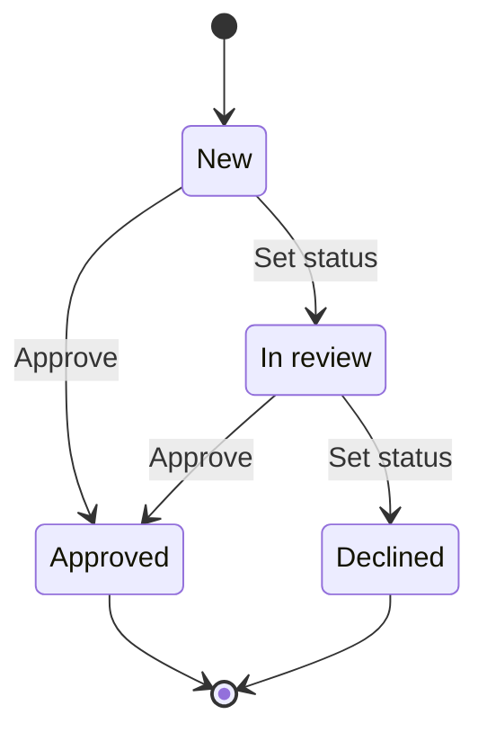

The Work Queue lists items waiting for a decision: submissions, requests or
cases. Each item has a reference (`WI-00042`), an account, a status, a priority,
an owner and an amount.

## Find items

- The tabs above the list are **views**: *Open*, *Assigned to me*, *Closed* and *All*.
- Type in the search box to match the reference, title, account or owner.
- Use the **Status**, **Priority** and **Owner** filters to narrow the list further.
- Click a column heading to sort by it; click again to reverse.

The address bar keeps your view, search, filters and sort, so you can share a
filtered list by copying the link.

## Work on items

Select one or more rows, then choose an action in the bar above the list:

| Action | What it does | Who can use it |
|---|---|---|
| Assign | Sets the owner of the selected items | Editors |
| Set status | Moves the items to a status you choose | Editors |
| Approve | Approves items that are *New* or *In review*; other items are skipped | Editors |
| Delete | Deletes the items. This cannot be undone | Administrators |

Items move through these statuses:

> [!NOTE]
> Every action is recorded in the item's activity and in the audit log, with who
> did it and when.

## Create an item

Choose **New item** (top right of the list, or *New item* in the sidebar). Only
the title is required. The reference is assigned when you save.

## The detail page

Click a row to see the item in the side panel, or double-click it (or press
**Enter**) to open its full page. The detail page shows every property, the
description and the item's activity. Editors can change the item with **Edit**.
