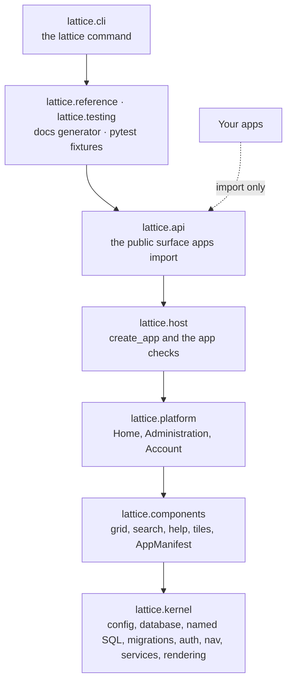
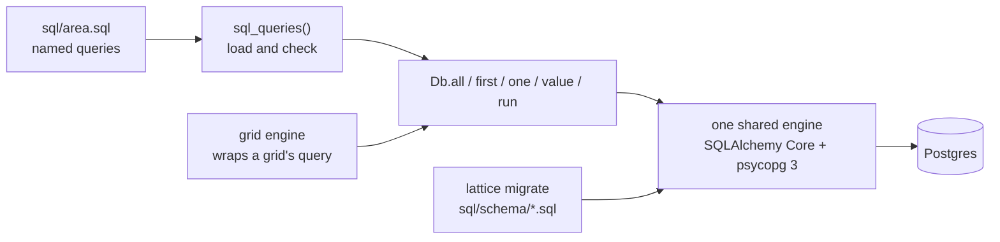

This page describes Lattice as it runs today. Where Lattice is going, and why,
is in [Decisions and direction](decisions.md).

## The layers

The `lattice` package is split into layers. Each imports only the layers below
it, and a test (`import-linter`, run by `make lint`) fails if one does not.

| Layer | Package | Holds | Does not hold |
|---|---|---|---|
| Kernel | `lattice.kernel` | Settings, the shared database engine and `Db`, the named-SQL loader, the migration runner, sign-in and sessions, the navigation registry, audit, users and preferences, template rendering, icons, slots, CSS rules | Any UI component |
| Components | `lattice.components` | The grid, Ctrl+J search, help, home tiles, and the `AppManifest` class | Pages of its own beyond the shared endpoints |
| Platform | `lattice.platform` | Lattice's own apps: Home, Administration and Account, each an `AppManifest` | Anything an app could not also do |
| Host | `lattice.host` | `create_app`: checks every app and wires it in | Feature code |
| API | `lattice.api` | Re-exports of the stable names. Nothing else | Code of its own |
| Tools | `lattice.cli`, `lattice.testing`, `lattice.reference` | The `lattice` command, test fixtures, the Reference generator | Anything a running host needs |

A second import rule applies to apps: they import only `lattice.api`. Anything
else in Lattice may change without notice; a name in `lattice.api` changes
only as a breaking change.

## What happens at startup

A host module calls `create_app(apps=[…])`. In order, it:

1. **Clears the registries**, so tests can build many hosts in one process.
2. **Checks the host folder** (when `host_dir` is given). Only the sign-in,
   error and home templates may be overridden, and `static/theme.css` may set
   only brand tokens.
3. **Checks every app.**
   - Its key is unique and not reserved.
   - Nav routes and grid paths start with `/{key}`, and grid keys with `{key}.`.
   - Templates live only in `templates/{key}/`, and slot templates in `{key}/`.
   - Every stylesheet is scoped to `[data-app="{key}"]` and follows the
     colour rules.
4. **Registers the apps** in rail order: Home, then the host's apps in the
   order given, then Administration and Account. Registering an app adds its:
   - nav nodes;
   - icons and slots;
   - grids, with their shared endpoints and Ctrl+J providers;
   - home tiles;
   - search providers.
5. **Loads help.** Lattice's own help is loaded first, then each app's
   `help/` folder. Every topic is rendered to HTML once, the links between
   topics and the `help.toml` page map are checked, and the search index is
   built.
6. **Sets the template search order**: the host's templates, then each app's,
   then Lattice's.
7. **Builds the FastAPI application**:
   - mounts static files (`/static/{key}/` for each app, `/static/host/`, then `/static/`);
   - adds the authentication middleware;
   - includes Lattice's shared routers (`/auth`, `/_grid`, `/_search`, `/help`);
   - includes each app's routers under its prefix.
8. **Starts background tasks.** On startup, each app's `background` coroutine
   starts; it is cancelled at shutdown.

Any rule broken in steps 2 to 5 raises `AppError` with the app and the rule in
the message, and the host does not start. Problems surface when the host is
built, in development and in tests, not when a user opens a page.

## The registries

`create_app` fills a few module-level registries. Everything the user sees is
built from them, so no part of Lattice imports an app.

| Registry | Filled from | Read by |
|---|---|---|
| Navigation (`lattice.kernel.nav`) | `AppManifest.nav` | The rail, sidebar, breadcrumbs, page titles, Ctrl+J pages, F1 |
| Grids (`lattice.components.grid`) | `AppManifest.grids` | The shared `/_grid/{key}/…` endpoints, Ctrl+J record sources, home tiles |
| Search providers (`lattice.components.search`) | Grids with `palette=`, `AppManifest.search`, help, commands | Ctrl+J |
| Tiles (`lattice.components.tiles`) | `AppManifest.tiles` | The home page |
| Help (`lattice.components.help`) | `AppManifest.help` folders | `/help`, F1, Ctrl+J, help search |
| Icons and slots (`lattice.kernel`) | `AppManifest.icons`, `slots`; host overrides | `icon()` and `slot()` in templates |

## A request, in detail

1. **Middleware.** `AuthMiddleware` lets public paths through (static files,
   the sign-in pages). For everything else it loads the session from the
   `lattice_session` cookie and applies three gates in order:
   - a valid session, else the sign-in page;
   - no forced password change, else the change-password page;
   - at least one role, else the waiting page.

   It then sets `request.state.user` to a `CurrentUser` and issues the CSRF
   token.
2. **Route.** FastAPI runs the matching route. Routers that change data
   carry `Depends(csrf_protect)`. Routes get the user from
   `Depends(current_user)` and the request's `Db` from `Depends(get_db)`: one
   transaction for the whole request, saved when the route returns;
   `require(permission)` returns 403 to anyone without that permission.
3. **Rendering.** `render_page(request, template, nav_key, **context)` builds
   the navigation context for that nav key: the rail, sidebar, breadcrumbs and
   title, with the menus filtered by role. It then renders the template inside
   `base/shell.html`. A flash message left by the previous request becomes a
   toast.
4. **In the browser.** Four small scripts, with no build step:

   | Script | Does |
   |---|---|
   | `app.js` | Global keys (Ctrl+J, F1, `?`), toasts, time formatting, the CSRF header on every request |
   | `grid.js` | The grid's Alpine component: selection, actions, dialogs, panel, keyboard, URL state |
   | `palette.js` | Ctrl+J: sources, results, preview, commands |
   | `help.js` | Draws Mermaid diagrams in help topics with the theme's colours |

   HTMX and Alpine.js are vendored in `static/js/vendor/`.

## Grids at run time

A grid page is built in two halves:

- **First load.** `render_grid_page` runs the query for the first page, so the
  page arrives complete.
- **Every later change.** Search, filter, sort, page or view calls
  `GET /_grid/{key}/rows`, which returns only the rows. The URL is updated, so
  a link reopens the same state.

**Actions** post to `POST /_grid/{key}/action/{action}`. The server then:

1. checks the action's roles;
2. reloads the selected rows through the grid's query, so a user can act only
   on rows they can see;
3. drops rows that fail `when`;
4. calls the handler;
5. writes one audit event per row, then commits.

Panels, CSV export and Ctrl+J results also go through the query. That is why
the query is the access boundary.

## Data

One Postgres database holds everything, one schema per owner:

| Schema | Holds | Files |
|---|---|---|
| `lattice` | `app_user`, `role`, `user_role`, `user_session`, `user_preference`, `audit_event`, and `utc_now()` | `lattice/sql/schema/`, queries in `lattice/sql/*.sql` |
| `demo`, … | Each app's tables | The app's `sql/schema/`, queries in its `sql/*.sql` |

- **No ORM.** Every statement is a named query in a `.sql` file. Only two
  modules build SQL in code: the grid engine and the migration runner.
- **One engine.** It is created on first use from `LATTICE_DATABASE_URL`, and
  shared by requests, the `lattice` command and background tasks.
- **One transaction per request.** It is saved when the route returns, and
  rolled back if the route raises.
- **Timestamps** are naive UTC from the database clock (`lattice.utc_now()`),
  formatted in the browser.
- **Tests** get a fresh database each, copied from a template migrated once per run.

How to work with it is in [Data and audit](../building-apps/data-and-audit.md).
Separate databases per app ("bindings") are not built; see
[Decisions and direction](decisions.md).
