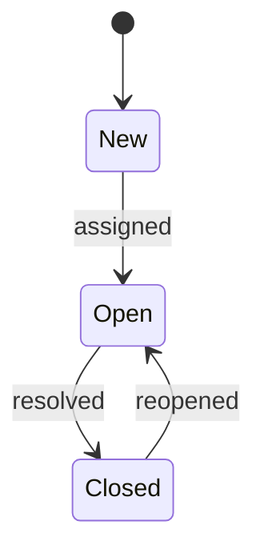

Every app should explain itself. An app's help is a folder of Markdown files.
Lattice turns it into:

- a section of the Help centre (`/help/{key}`);
- results in help search and in Ctrl+J;
- the target of F1 and "Help for this page" on each of the app's pages.

## The folder

```text
help/
  index.md                the app's help home (required)
  tickets.md              a topic: /help/helpdesk/tickets
  reports/index.md        a section page: /help/helpdesk/reports
  reports/weekly.md       a topic in that section: /help/helpdesk/reports/weekly
  images/sla.png          files that topics link to
  help.toml               which topic each page's F1 opens (optional)
```

Point the manifest at it:

```python
APP = AppManifest(key="helpdesk", …, help=Path(__file__).parent / "help")
```

The navigation tree on the left of every help page follows the folders:

- a folder with an `index.md` is a section;
- the topics in it are listed under it.

Previous and Next links at the foot of each topic follow the same order.

## Front matter

Every topic starts with a front matter block:

```markdown
---
title: Closing tickets
summary: Close one ticket or many, and reopen a ticket closed by mistake.
order: 20
keywords: resolve done finish
permission: helpdesk.tickets.edit
---
```

| Key | Use |
|---|---|
| `title` | Required. The heading and the name in the tree and search results |
| `summary` | One sentence under the title, in search results and in section lists |
| `order` | Sorts topics within a section; lower first. Default 100, then by title |
| `keywords` | Words searched but not shown: synonyms users might type |
| `permission` | Only users with this permission see the topic. Default: everyone |

## Writing

Topics are CommonMark Markdown, with these additions:

| Feature | How |
|---|---|
| Tables, ~~strikethrough~~, task lists | GitHub syntax |
| Links between topics | Relative links to the `.md` file: `[Closing](tickets.md#close-a-ticket)`, `[Weekly](reports/weekly.md)` |
| Images and other files | Relative links: `` |
| Code with highlighting | Fenced blocks with a language: ```` ```python ```` |
| Diagrams | Fenced `mermaid` blocks, drawn in the theme's colours |
| Callouts | `> [!NOTE]`, `> [!TIP]`, `> [!IMPORTANT]`, `> [!WARNING]`, `> [!CAUTION]` on the first line of a quote |
| Headings | `##` and `###` are listed under "On this page" and get anchors from their text: `## Close a ticket` → `#close-a-ticket` |

A callout:

```markdown
> [!WARNING]
> Closing a ticket emails the customer. Closing many tickets emails each customer.
```

A diagram:

````markdown

````

Raw HTML is not allowed: it is shown as text. Links to sites outside the help
work as usual.

## Contextual help: help.toml

Map each nav key to the topic F1 should open:

```toml
[pages]
"tickets" = "tickets"
"tickets.new" = "tickets#open-a-ticket"
"tickets.detail" = "tickets#working-on-a-ticket"
"reports" = "reports/index"
```

- **Values.** A value is a topic path without `.md` (`index` is the help
  home), optionally followed by `#heading`.
- **Unmapped pages.** A page that is not listed opens the app's help home.
- **Checks.** Every key must be one of the app's own nav keys, and every
  topic and heading must exist.

## What is checked

When the host starts, `create_app` reads every topic and refuses to start
(with the file and the problem in the message) if:

- there is no `index.md`;
- a topic has no front matter, or no title;
- a link to another topic points to a file that does not exist;
- a link leaves the help folder;
- `help.toml` names a page the app does not own, a missing topic, or a
  missing heading.

The app's tests start a host, so a broken help folder fails `make test`.

## Search

Help search runs in the server, with no external service:

- **Matching.** Every word of the query must match. The last word also matches
  as a prefix, so results appear while the user is typing.
- **Word forms.** Words are stemmed: "closing" finds "close" and "closed".
- **Ranking.** A match in the title counts most, then keywords and headings,
  then the summary, then the body.
- **Roles.** Topics a user may not see are never returned.

To be found, put the words users type in the title, the headings or
`keywords`.

## Style

Write help the way the Lattice docs are written:

- **Answer first.** Start each topic with what the user can do there.
- **One task per heading.** Name the heading after the task ("Close a
  ticket"), so F1 can land on it.
- **Name the real thing.** Write "choose **Close**", in bold, exactly as the
  button is labelled.
- **Lists for steps.** Keep sentences short, and use numbered steps for a
  sequence.
- **Callouts sparingly.** Use one for a warning or a tip that would otherwise
  be missed.
