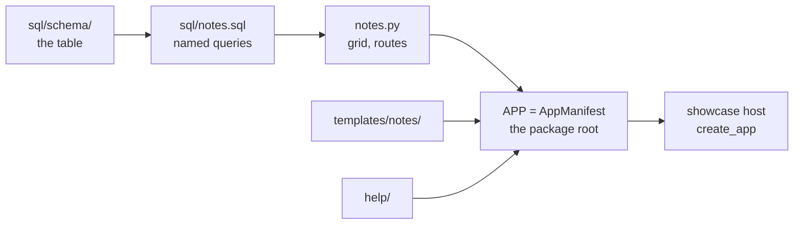

In this tutorial you build **Notes**, an app where editors write short notes
that the whole team can read. By the end you will have:

- a database table, created by a migration;
- named SQL queries in a `.sql` file;
- a list page with search, views, bulk actions and Ctrl+J results;
- a form that creates a note and records it in the audit log;
- permissions that decide who may write and delete notes;
- help topics, with F1 landing on the right one;
- tests for the pages, the form and the permissions.

It takes about 30 minutes. You need Lattice and its Postgres database running
first; see [Getting started](index.md).



## Step 1: Create the package

An app is its own Python package in `apps/`. Create the folders:

```bash
mkdir -p apps/notes/lattice_notes/sql/schema apps/notes/lattice_notes/templates/notes \
         apps/notes/lattice_notes/help apps/notes/tests/sql
```

Create `apps/notes/pyproject.toml`:

```toml
[build-system]
requires = ["hatchling"]
build-backend = "hatchling.build"

[project]
name = "lattice-notes"
version = "0.1.0"
description = "Notes: a Lattice app for short shared notes."
requires-python = ">=3.14"
dependencies = ["lattice"]

[tool.uv.sources]
lattice = { workspace = true }

[tool.hatch.build.targets.wheel]
packages = ["lattice_notes"]
```

The package depends on `lattice` and nothing else. It will import only
`lattice.api`.

## Step 2: Create the table

An app's tables live in its own Postgres schema, named after the app's key:
`notes`. Lattice creates the schema, then runs the app's migration files in
order. Create `apps/notes/lattice_notes/sql/schema/0001_notes.sql`:

```sql
-- The notes app's table. Lattice creates the notes schema before running this file.

CREATE TABLE notes.note (
  id         bigint       GENERATED ALWAYS AS IDENTITY PRIMARY KEY,
  title      varchar(200) NOT NULL,
  body       text         NOT NULL DEFAULT '',
  pinned     boolean      NOT NULL DEFAULT false,
  author_id  bigint       NOT NULL REFERENCES lattice.app_user (id),
  created_at timestamp    NOT NULL DEFAULT lattice.utc_now()
);
```

Points to notice:

- **Timestamps** are naive UTC from the database's clock, `lattice.utc_now()`.
  The browser shows them in the user's time zone.
- **People.** `author_id` points at `lattice.app_user`, Lattice's user table.
  Apps may refer to Lattice's tables, but never to another app's tables.
- **Never edit a migration that has run** somewhere else. A change is a new file:
  `0002_….sql`. `make migration schema=notes m="add a colour"` creates the next one.

## Step 3: Write the queries

Every SQL statement an app runs is a **named query** in a `.sql` file in its
`sql/` folder, one file per area. Python refers to queries by name and never
contains SQL. Create `apps/notes/lattice_notes/sql/notes.sql`:

```sql
-- Notes: short notes shared with the team.

-- name: grid
-- Every note with its author's name. The grid adds search, filters, sort and paging.
SELECT n.id, n.title, n.body, n.pinned, n.created_at, u.display_name AS author
FROM notes.note n
JOIN lattice.app_user u ON u.id = n.author_id;

-- name: create
-- A new note. Returns its id.
INSERT INTO notes.note (title, body, author_id) VALUES (:title, :body, :author_id)
RETURNING id;

-- name: pin
-- Pin notes.
UPDATE notes.note SET pinned = true WHERE id = ANY(:ids);

-- name: delete
-- Delete notes.
DELETE FROM notes.note WHERE id = ANY(:ids);
```

The rules, which Lattice checks:

- **Each query has a name and a comment.** It starts with `-- name:` and the
  next line is a `--` comment saying what it does.
- **Values are placeholders,** such as `:title` and `:ids`, bound separately and
  never pasted into the SQL. A Python list becomes a Postgres array, so
  `id = ANY(:ids)` matches any of them.
- **Casts need `CAST`.** Write `CAST(:x AS date)`, not `:x::date`: a placeholder
  followed by `::` is not bound, and Lattice refuses to load it.

## Step 4: Describe the list

Every list of records in Lattice is a `GridSpec`. You give it a named query and
a description of the columns, views and actions. Lattice draws the page and
handles searching, paging, selection, dialogs and export.

Create `apps/notes/lattice_notes/notes.py` and start with the grid:

```python
"""The Notes list and the New note form."""

from __future__ import annotations

from pathlib import Path

from fastapi import APIRouter, Depends, Request
from fastapi.responses import RedirectResponse

from lattice.api import (
    Action,
    ActionContext,
    Column,
    Db,
    GridSpec,
    Palette,
    Permission,
    View,
    audit,
    csrf_protect,
    current_user,
    flash,
    get_db,
    render_grid_page,
    render_page,
    require,
    sql_queries,
)

SQL = sql_queries(Path(__file__).parent / "sql").notes
WRITE, DELETE = "notes.write", "notes.delete"
PERMISSIONS = [
    Permission(WRITE, "Write notes", "Create and pin notes.", default_roles=("editor",)),
    Permission(DELETE, "Delete notes", "Delete notes for good."),
]


def pin(ctx: ActionContext) -> str:
    ctx.db.run(SQL.pin, ids=ctx.ids)
    return f"Pinned {ctx.count} note(s)."


def remove(ctx: ActionContext) -> str:
    ctx.db.run(SQL.delete, ids=ctx.ids)
    return f"Deleted {ctx.count} note(s)."


GRID = GridSpec(
    key="notes.notes",
    title="Notes",
    path="/notes",
    query=SQL.grid,
    columns=[
        Column("title", "Title", kind="strong", secondary="body", required=True),
        Column("pinned", "Pinned", kind="bool", width="90px"),
        Column("author", "Author", kind="user", width="180px"),
        Column("created_at", "Created", kind="ago", width="130px"),
    ],
    search=["title", "body", "author"],
    views=[View("all", "All"), View("pinned", "Pinned", where={"pinned": [True]})],
    actions=[
        Action("new", "New note", scope="none", href="/notes/new", tone="primary", icon="plus",
               permission=WRITE),
        Action("pin", "Pin", handler=pin, icon="star", permission=WRITE, when={"pinned": [False]}),
        Action("delete", "Delete", handler=remove, tone="danger", icon="trash", permission=DELETE,
               confirm="Delete {count} note(s)?"),
    ],
    default_sort="-created_at",
    palette=Palette(title="{title}", subtitle="{author}", href="/notes?q={title}", icon="edit"),
)
```

What each part does:

**`PERMISSIONS`** are what the app's users may do. Notes declares two:
`notes.write`, which `lattice migrate` gives to the editor role the first time
it runs, and `notes.delete`, which only administrators have until someone grants
it to a role in **Administration › Roles**. Permission keys start with the app's key.

**`SQL = sql_queries(…).notes`** loads the queries in `sql/notes.sql`;
`SQL.grid` is the query named `grid`. A misspelt name stops with an error
naming the file and query.

**`query=SQL.grid`** returns the rows. Each column it selects is a row key that
`Column`, `search`, `View` and `Palette` refer to, and `id` must be one of them.
Lattice wraps the query and adds the search, filters, sort and paging around
it. The query is also the access boundary: rows it does not return cannot be
seen, exported, found in Ctrl+J or acted on. To scope rows to the signed-in
user, a query may use `:user_id`.

**`columns`**: `kind` chooses how a value renders: `strong` text, a `bool` tick,
a `user` chip or a relative time (`ago`). `secondary="body"` shows the body as
a muted second line under the title.

**`views`** are tabs of preset filters. **Pinned** shows rows where `pinned` is true.

**`actions`** are the buttons:

- **New note** needs no selection (`scope="none"`) and opens a page.
- **Pin** runs `pin` on the selected rows. `when` limits it to rows that are
  not pinned yet; other selected rows are skipped and the toast says how many.
- **Delete** asks for confirmation and needs `notes.delete`.

Handlers run a named query with `ctx.db.run(…)`. They never commit: the whole
request is one transaction, saved when it succeeds, together with the audit
event the grid writes for each row.

**`permission`**: each action names the permission it needs. Hiding a button is
not access control: the server checks the permission again when the action
runs, so an editor who posts to the delete action directly gets a 403.

**`palette`** makes notes findable from Ctrl+J. Each placeholder is filled from the row.

## Step 5: Add the routes

Add to the end of `notes.py`:

```python
router = APIRouter(dependencies=[Depends(csrf_protect)])


@router.get("")
def notes_list(request: Request, db: Db = Depends(get_db)):
    return render_grid_page(request, db, GRID, "notes.list")


@router.get("/new", dependencies=[Depends(require(WRITE))])
def new_form(request: Request):
    return render_page(request, "notes/new.html", "notes.new", errors={}, values={})


@router.post("/new", dependencies=[Depends(require(WRITE))])
async def create(request: Request, db: Db = Depends(get_db), user=Depends(current_user)):
    form = await request.form()
    values = {"title": (form.get("title") or "").strip(), "body": form.get("body") or ""}
    if not values["title"]:
        return render_page(request, "notes/new.html", "notes.new", status_code=400,
                           errors={"title": "Give the note a title."}, values=values)
    note_id = db.value(SQL.create, author_id=user.id, **values)
    audit.record(db, user.id, "notes.create", f"Created note {values['title']}",
                 target_type="notes.notes", target_id=note_id)
    response = RedirectResponse("/notes", status_code=303)
    flash(response, request, "Note created.")
    return response
```

The routes follow the Lattice rules for pages and forms:

- **Prefix.** Paths are relative. Lattice mounts the router under the app's
  key, so `""` is `/notes` and `"/new"` is `/notes/new`.
- **Database.** `db: Db = Depends(get_db)` gives the request's database
  connection. `db.value` runs a query and returns one value, here the new
  note's id. Nothing is saved until the route returns; if it raises, nothing is.
- **Permissions.** `require(WRITE)` returns 403 to anyone without
  `notes.write`, even if they type the URL.
- **CSRF.** `csrf_protect` on the router rejects any form post without the CSRF
  token.
- **Pages.** `render_grid_page` and `render_page` take a nav key (`notes.list`,
  `notes.new`). It tells the shell which page is open.
- **Forms.** A form that fails validation renders again with status 400 and an
  error for each field. A form that succeeds redirects with 303. The `flash`
  message appears as a toast on the next page.
- **Audit.** Writes outside grid actions call `audit.record` themselves.

## Step 6: Write the form template

Create `apps/notes/lattice_notes/templates/notes/new.html`:

```jinja



<div class="page page--narrow">
  {{ page_header("New note") }}
  <form method="post" action="/notes/new" class="stack-lg">
    {{ csrf_field() }}
    
      <div class="stack">
        {{ field("title", "Title", values.title, error=errors.title, required=True) }}
        {{ field("body", "Note", values.body, type="textarea") }}
      </div>
    
    <div class="form-actions">
      <a class="btn btn--ghost" href="/notes">Cancel</a>
      <button class="btn btn--primary" type="submit">Create</button>
    </div>
  </form>
</div>

```

The template has no styling of its own:

- the layout comes from the shell;
- `page_header`, `card` and `field` are shared [macros](../reference/macros.md);
- `csrf_field()` adds the token the router checks.

It lives under `templates/notes/` because an app's templates must sit in a
folder named after its key.

## Step 7: Write the manifest

The manifest tells Lattice what the app adds. Create
`apps/notes/lattice_notes/__init__.py`:

```python
"""Notes: short shared notes. The app built in the Lattice tutorial."""

from pathlib import Path

from lattice.api import AppManifest, NavNode
from lattice_notes import notes

HERE = Path(__file__).parent

APP = AppManifest(
    key="notes",
    label="Notes",
    icon="edit",
    nav=[
        NavNode("notes", "Notes", "/notes", icon="edit", keywords="memo jot",
                description="Short notes shared with the team"),
        NavNode("notes.list", "All notes", "/notes", parent="notes"),
        NavNode("notes.new", "New note", "/notes/new", parent="notes", permission=notes.WRITE),
    ],
    routers=[notes.router],
    grids=[notes.GRID],
    permissions=notes.PERMISSIONS,
    sql=HERE / "sql",
    templates=HERE / "templates",
    help=HERE / "help",
)
```

The `nav` list builds the navigation:

- The top-level node (`notes`) becomes an icon in the rail.
- Its children become the sidebar.
- Ctrl+J finds every node by its label, keywords and description.
- `permission=notes.WRITE` hides **New note** from people who can't write.

`sql=HERE / "sql"` tells Lattice where the app's migrations are, so
`lattice migrate` creates the `notes` schema and its table.
`permissions=notes.PERMISSIONS` declares the permissions; the host refuses to
start if any page, grid or action names one that no app declares.

## Step 8: Write the help

Every app should explain itself. Create
`apps/notes/lattice_notes/help/index.md`:

```markdown
---
title: Notes
summary: Write short notes and share them with your team.
---

Notes keeps short notes everyone can read. Editors write and pin notes;
administrators can delete them.

## Write a note

Choose **New note**, give it a title, and choose **Create**.

## Pin a note

Select one or more notes and choose **Pin**. The **Pinned** view lists only pinned notes.
```

Then tell F1 where to land. Create
`apps/notes/lattice_notes/help/help.toml`:

```toml
[pages]
"notes.new" = "index#write-a-note"
```

On the New note page, F1 now opens the **Write a note** section. Pages that
are not listed open the app's help home.

## Step 9: Add the app to the host

The showcase host runs the showcase app. Add Notes to it.

1. **Install the package.** In the root `pyproject.toml`:
   - add `"lattice-notes"` to the `dev` dependency group;
   - add `lattice-notes = { workspace = true }` under `[tool.uv.sources]`;
   - add `"apps/notes/tests"` to `testpaths`;
   - add `"lattice_notes"` to ruff's `known-first-party`.
2. **Import rules.** In the same file, under `[tool.importlinter]`, add
   `"lattice_notes"` to `root_packages`, and to `source_modules` in the two app
   contracts. `make lint` then checks that Notes imports only `lattice.api`.
3. **Host dependency.** In `hosts/showcase/pyproject.toml`, add `"lattice-notes"` to
   `dependencies` and the same `[tool.uv.sources]` line.
4. **Register the app.** In `hosts/showcase/showcase_host/main.py`:

   ```python
   import lattice_showcase
   import lattice_notes
   from lattice.host import create_app

   app = create_app(apps=[lattice_showcase.APP, lattice_notes.APP])
   ```

Then install the package and create the table:

```bash
uv sync --all-packages
make migrate
```

`make migrate` prints `Applied: notes/0001_notes.sql` and
`New permissions: notes.delete, notes.write`; the editor role now has
`notes.write`. Restart `make dev`.

## Step 10: Try it

Sign in as `editor@example.com` and try each part:

- **Rail.** A pencil icon appears in the rail. Open it.
- **Form.** Choose **New note**, enter a title and choose **Create**. You
  return to the list with a "Note created." toast.
- **Pin.** Select the note and choose **Pin**. Open the **Pinned** view.
- **Ctrl+J.** Press **Ctrl J** and type part of the title. The note appears
  under **Notes**.
- **F1.** On **New note**, press **F1**. Help opens at **Write a note**.

Now sign in as `viewer@example.com`:

- there is no **New note** button or menu entry, and no **Pin**;
- `/notes/new` returns 403.

To let viewers write notes too, an administrator ticks **Write notes** on the
Viewer role in **Administration › Roles**. No code changes.

## Step 11: Test it

Create `apps/notes/tests/conftest.py`. It tells the Lattice test fixtures to
run a host with your app:

```python
import pytest

import lattice_notes


@pytest.fixture
def host_apps():
    return [lattice_notes.APP]
```

Tests set up and check rows with named queries too. Create
`apps/notes/tests/sql/checks.sql`:

```sql
-- Queries the Notes tests use to set up and check rows.

-- name: add_note
-- A note for a test. Returns its id.
INSERT INTO notes.note (title, author_id) VALUES (:title, :author_id) RETURNING id;

-- name: note_by_title
-- The note with this title.
SELECT id, title, body, pinned FROM notes.note WHERE title = :title;
```

Create `apps/notes/tests/test_notes.py`:

```python
from pathlib import Path

from lattice.api import sql_queries
from lattice.testing import csrf, post_json

CHECK = sql_queries(Path(__file__).parent / "sql").checks


def test_viewers_read_but_do_not_write(as_user):
    viewer = as_user("viewer")
    assert viewer.get("/notes").status_code == 200
    assert viewer.get("/notes/new").status_code == 403


def test_editor_creates_a_note(as_user, db):
    c = as_user("editor")
    resp = c.post("/notes/new", data={"title": "", "csrf_token": csrf(c)})
    assert resp.status_code == 400 and "Give the note a title" in resp.text
    resp = c.post("/notes/new", data={"title": "Hello", "body": "First", "csrf_token": csrf(c)},
                  follow_redirects=False)
    assert resp.status_code == 303
    assert db.one(CHECK.note_by_title, title="Hello")["body"] == "First"


def test_only_admins_delete(as_user, db, users):
    note_id = db.value(CHECK.add_note, title="Old", author_id=users["editor"].id)
    assert post_json(as_user("editor"), "/_grid/notes.notes/action/delete",
                     {"ids": [note_id]}).status_code == 403
    assert post_json(as_user("admin"), "/_grid/notes.notes/action/delete",
                     {"ids": [note_id]}).status_code == 200
    assert db.first(CHECK.note_by_title, title="Old") is None
```

The fixtures come from `lattice.testing`:

| Fixture | Gives you |
|---|---|
| `db` | A fresh Postgres database for each test, already migrated, and a `Db` on it. Each call is saved at once |
| `users` | An admin, an editor and a viewer |
| `as_user(role)` | A test client signed in as that user |

Grid actions are posted as JSON to `/_grid/{grid key}/action/{action key}`.

Run everything:

```bash
make test
make lint
```

Two of Lattice's own checks now cover Notes too:

- **Imports.** `make lint` fails if `notes.py` imports anything from Lattice
  other than `lattice.api`, or imports SQLAlchemy directly.
- **SQL.** `make test` fails on:
  - a named query in `notes.sql` that no code uses;
  - a query name the code uses that doesn't exist;
  - a query Postgres rejects;
  - a SQL statement written as a string in Python.

## What you built

| File | Role |
|---|---|
| `sql/schema/0001_notes.sql` | The `notes.note` table |
| `sql/notes.sql` | The named queries: the grid, create, pin, delete |
| `notes.py` | The permissions, the grid, its actions and the routes |
| `templates/notes/new.html` | The form, built from shared macros |
| `__init__.py` | The manifest: pages, routes, grid, permissions, SQL, templates, help |
| `help/` | Topics, and the F1 map in `help.toml` |
| `tests/` | Pages, the form and permissions, with their own named queries |

From here:

- **Detail page.** Declare a `RecordPage` on the grid, as `DETAIL` in
  `apps/showcase/lattice_showcase/items.py` ([Record pages](../building-apps/record-pages.md)).
- **Side panel.** Add `panel=` to the grid.
- **Home page tile.** Add `HomeTile("Pinned notes", GRID, view="pinned")` to
  the manifest's `tiles`.
- **Reference.** Look up any class or setting in
  [Reference](../reference/index.md).
