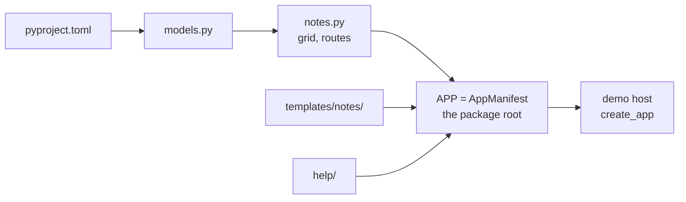

In this tutorial you build **Notes**, an app where editors write short notes
that the whole team can read. By the end you will have:

- a database table and its migration;
- a list page with search, views, bulk actions and Ctrl+J results;
- a form that creates a note and records it in the audit log;
- help topics, with F1 landing on the right one;
- tests for the pages, the form and the permissions.

It takes about 30 minutes. You need Lattice running first; see
[Getting started](index.md).



## Step 1: Create the package

An app is its own Python package in `apps/`. Create the folders:

```bash
mkdir -p apps/notes/lattice_notes/templates/notes apps/notes/lattice_notes/help apps/notes/tests
```

Create `apps/notes/pyproject.toml`:

```toml
[build-system]
requires = ["hatchling"]
build-backend = "hatchling.build"

[project]
name = "lattice-notes"
version = "0.1.0"
description = "Notes: a Lattice app for short shared notes."
requires-python = ">=3.14"
dependencies = ["lattice"]

[tool.uv.sources]
lattice = { workspace = true }

[tool.hatch.build.targets.wheel]
packages = ["lattice_notes"]
```

The package depends on `lattice` and nothing else. It will import only
`lattice.api`.

## Step 2: Define the table

Create `apps/notes/lattice_notes/models.py`:

```python
"""The notes app's tables."""

from __future__ import annotations

from datetime import datetime

from sqlalchemy import Boolean, DateTime, ForeignKey, String, Text
from sqlalchemy.orm import Mapped, mapped_column

from lattice.api import Base, utcnow


class Note(Base):
    __tablename__ = "note"

    id: Mapped[int] = mapped_column(primary_key=True)
    title: Mapped[str] = mapped_column(String(200))
    body: Mapped[str] = mapped_column(Text, default="")
    pinned: Mapped[bool] = mapped_column(Boolean, default=False)
    author_id: Mapped[int] = mapped_column(ForeignKey("app_user.id"))
    created_at: Mapped[datetime] = mapped_column(DateTime, default=utcnow)
```

Points to notice:

- Models extend `Base` from `lattice.api`, so they share Lattice's metadata and migrations.
- Timestamps are naive UTC (`utcnow`). The browser shows them in the user's time zone.
- `author_id` points at `app_user`, Lattice's user table. Apps may refer to Lattice's
  tables, but never to another app's tables.

## Step 3: Describe the list

Every list of records in Lattice is a `GridSpec`. You give it a query and a
description of the columns, views and actions. Lattice draws the page and
handles searching, paging, selection, dialogs and export.

Create `apps/notes/lattice_notes/notes.py` and start with the grid:

```python
"""The Notes list and the New note form."""

from __future__ import annotations

from fastapi import APIRouter, Depends, Request
from fastapi.responses import RedirectResponse
from sqlalchemy import delete, select, update
from sqlalchemy.orm import Session

from lattice.api import (
    ADMINS,
    EDITORS,
    Action,
    ActionContext,
    Column,
    GridSpec,
    Palette,
    User,
    View,
    audit,
    csrf_protect,
    current_user,
    flash,
    get_db,
    render_grid_page,
    render_page,
    require_roles,
)
from lattice_notes.models import Note


def query(db: Session, user):
    return (select(Note.id, Note.title, Note.body, Note.pinned, Note.created_at,
                   User.display_name.label("author"))
            .join(User, User.id == Note.author_id))


def pin(ctx: ActionContext) -> str:
    ctx.db.execute(update(Note).where(Note.id.in_(ctx.ids)).values(pinned=True))
    return f"Pinned {ctx.count} note(s)."


def remove(ctx: ActionContext) -> str:
    ctx.db.execute(delete(Note).where(Note.id.in_(ctx.ids)))
    return f"Deleted {ctx.count} note(s)."


GRID = GridSpec(
    key="notes.notes",
    title="Notes",
    path="/notes",
    query=query,
    columns=[
        Column("title", "Title", kind="strong", secondary="body", required=True),
        Column("pinned", "Pinned", kind="bool", width="90px"),
        Column("author", "Author", kind="user", width="180px"),
        Column("created_at", "Created", kind="ago", width="130px"),
    ],
    search=["title", "body", "author"],
    views=[View("all", "All"), View("pinned", "Pinned", where={"pinned": [True]})],
    actions=[
        Action("new", "New note", scope="none", href="/notes/new", tone="primary", icon="plus",
               roles=EDITORS),
        Action("pin", "Pin", handler=pin, icon="star", roles=EDITORS, when={"pinned": [False]}),
        Action("delete", "Delete", handler=remove, tone="danger", icon="trash", roles=ADMINS,
               confirm="Delete {count} note(s)?"),
    ],
    default_sort="-created_at",
    palette=Palette(title="{title}", subtitle="{author}", href="/notes?q={title}", icon="edit"),
)
```

What each part does:

**`query`** returns the rows as a SQLAlchemy `select`. Each column's label
becomes a row key that `Column`, `search`, `View` and `Palette` refer to, and
`id` must be one of them. The query is also the access boundary: rows it does
not return cannot be seen, exported, found in Ctrl+J or acted on.

**`columns`**: `kind` chooses how a value renders: `strong` text, a `bool` tick,
a `user` chip or a relative time (`ago`). `secondary="body"` shows the body as
a muted second line under the title.

**`views`** are tabs of preset filters. **Pinned** shows rows where `pinned` is true.

**`actions`** are the buttons:

- **New note** needs no selection (`scope="none"`) and opens a page.
- **Pin** runs `pin` on the selected rows. `when` limits it to rows that are
  not pinned yet; other selected rows are skipped and the toast says how many.
- **Delete** asks for confirmation and is for administrators only.

Handlers change rows but do not commit. The grid writes an audit event for each
row, then commits.

**`roles`**: hiding a button is not access control. The server checks `roles`
again when an action runs, so an editor who posts to the delete action directly
gets a 403.

**`palette`** makes notes findable from Ctrl+J. Each placeholder is filled from the row.

## Step 4: Add the routes

Add to the end of `notes.py`:

```python
router = APIRouter(dependencies=[Depends(csrf_protect)])


@router.get("")
def notes_list(request: Request, db: Session = Depends(get_db)):
    return render_grid_page(request, db, GRID, "notes.list")


@router.get("/new", dependencies=[Depends(require_roles(*EDITORS))])
def new_form(request: Request):
    return render_page(request, "notes/new.html", "notes.new", errors={}, values={})


@router.post("/new", dependencies=[Depends(require_roles(*EDITORS))])
async def create(request: Request, db: Session = Depends(get_db), user=Depends(current_user)):
    form = await request.form()
    values = {"title": (form.get("title") or "").strip(), "body": form.get("body") or ""}
    if not values["title"]:
        return render_page(request, "notes/new.html", "notes.new", status_code=400,
                           errors={"title": "Give the note a title."}, values=values)
    note = Note(author_id=user.id, **values)
    db.add(note)
    db.flush()
    audit.record(db, user.id, "notes.create", f"Created note {note.title}",
                 target_type="notes.notes", target_id=note.id)
    db.commit()
    response = RedirectResponse("/notes", status_code=303)
    flash(response, request, "Note created.")
    return response
```

The routes follow the Lattice rules for pages and forms:

- **Prefix.** Paths are relative. Lattice mounts the router under the app's
  key, so `""` is `/notes` and `"/new"` is `/notes/new`.
- **CSRF.** `csrf_protect` on the router rejects any form post without the CSRF
  token.
- **Pages.** `render_grid_page` and `render_page` take a nav key (`notes.list`,
  `notes.new`). It tells the shell which page is open.
- **Forms.** A form that fails validation renders again with status 400 and an
  error for each field. A form that succeeds redirects with 303. The `flash`
  message appears as a toast on the next page.
- **Audit.** Writes outside grid actions call `audit.record`, then commit.

## Step 5: Write the form template

Create `apps/notes/lattice_notes/templates/notes/new.html`:

```jinja



<div class="page page--narrow">
  {{ page_header("New note") }}
  <form method="post" action="/notes/new" class="stack-lg">
    {{ csrf_field() }}
    
      <div class="stack">
        {{ field("title", "Title", values.title, error=errors.title, required=True) }}
        {{ field("body", "Note", values.body, type="textarea") }}
      </div>
    
    <div class="form-actions">
      <a class="btn btn--ghost" href="/notes">Cancel</a>
      <button class="btn btn--primary" type="submit">Create</button>
    </div>
  </form>
</div>

```

The template has no styling of its own:

- the layout comes from the shell;
- `page_header`, `card` and `field` are shared [macros](../reference/macros.md);
- `csrf_field()` adds the token the router checks.

It lives under `templates/notes/` because an app's templates must sit in a
folder named after its key.

## Step 6: Write the manifest

The manifest tells Lattice what the app adds. Create
`apps/notes/lattice_notes/__init__.py`:

```python
"""Notes: short shared notes. The app built in the Lattice tutorial."""

from pathlib import Path

from lattice.api import AppManifest, NavNode
from lattice_notes import notes

HERE = Path(__file__).parent

APP = AppManifest(
    key="notes",
    label="Notes",
    icon="edit",
    nav=[
        NavNode("notes", "Notes", "/notes", icon="edit", keywords="memo jot",
                description="Short notes shared with the team"),
        NavNode("notes.list", "All notes", "/notes", parent="notes"),
        NavNode("notes.new", "New note", "/notes/new", parent="notes"),
    ],
    routers=[notes.router],
    grids=[notes.GRID],
    templates=HERE / "templates",
    help=HERE / "help",
)
```

The `nav` list builds the navigation:

- The top-level node (`notes`) becomes an icon in the rail.
- Its children become the sidebar.
- Ctrl+J finds every node by its label, keywords and description.

## Step 7: Write the help

Every app should explain itself. Create
`apps/notes/lattice_notes/help/index.md`:

```markdown
---
title: Notes
summary: Write short notes and share them with your team.
---

Notes keeps short notes everyone can read. Editors write and pin notes;
administrators can delete them.

## Write a note

Choose **New note**, give it a title, and choose **Create**.

## Pin a note

Select one or more notes and choose **Pin**. The **Pinned** view lists only pinned notes.
```

Then tell F1 where to land. Create
`apps/notes/lattice_notes/help/help.toml`:

```toml
[pages]
"notes.new" = "index#write-a-note"
```

On the New note page, F1 now opens the **Write a note** section. Pages that
are not listed open the app's help home.

Larger apps add more topics: one Markdown file per topic, and a folder with
its own `index.md` for each section.

## Step 8: Add the app to the host

The demo host runs the demo app. Add Notes to it.

1. **Install the package.** In the root `pyproject.toml`:
   - add `"lattice-notes"` to the `dev` dependency group;
   - add `lattice-notes = { workspace = true }` under `[tool.uv.sources]`;
   - add `"apps/notes/tests"` to `testpaths`;
   - add `"lattice_notes"` to ruff's `known-first-party`.
2. **Host dependency.** In `hosts/demo/pyproject.toml`, add `"lattice-notes"` to
   `dependencies` and the same `[tool.uv.sources]` line.
3. **Register the app.** In `hosts/demo/demo_host/main.py`:

   ```python
   import lattice_demo
   import lattice_notes
   from lattice.host import create_app

   app = create_app(apps=[lattice_demo.APP, lattice_notes.APP])
   ```

4. **Migrations.** In `alembic/env.py`, import the models so Alembic sees the
   table:

   ```python
   from lattice_notes import models as notes_models  # noqa: F401
   ```

   > [!NOTE]
   > For now every app shares one migration history in `alembic/`. A later
   > version of Lattice gives each app its own migrations and its own database
   > connection.

Then install the package and create the table:

```bash
uv sync --all-packages
make revision m="add note table"
make migrate
```

Open the new file in `alembic/versions/` and read it. It should create the
`note` table and nothing else. Restart `make dev`.

## Step 9: Try it

Sign in as `editor@example.com` and try each part:

- **Rail.** A pencil icon appears in the rail. Open it.
- **Form.** Choose **New note**, enter a title and choose **Create**. You
  return to the list with a "Note created." toast.
- **Pin.** Select the note and choose **Pin**. Open the **Pinned** view.
- **Ctrl+J.** Press **Ctrl J** and type part of the title. The note appears
  under **Notes**.
- **F1.** On **New note**, press **F1**. Help opens at **Write a note**.

Now sign in as `viewer@example.com`:

- there is no **New** or **Pin** button;
- `/notes/new` returns 403.

## Step 10: Test it

Create `apps/notes/tests/conftest.py`. It tells the Lattice test fixtures to
run a host with your app:

```python
import pytest

import lattice_notes


@pytest.fixture
def host_apps():
    return [lattice_notes.APP]
```

Create `apps/notes/tests/test_notes.py`:

```python
from sqlalchemy import select

from lattice.testing import csrf, post_json
from lattice_notes.models import Note


def test_list_renders_for_viewers(as_user):
    assert as_user("viewer").get("/notes").status_code == 200


def test_editor_creates_a_note(as_user, db):
    c = as_user("editor")
    resp = c.post("/notes/new", data={"title": "", "csrf_token": csrf(c)})
    assert resp.status_code == 400 and "Give the note a title" in resp.text
    resp = c.post("/notes/new", data={"title": "Hello", "body": "First", "csrf_token": csrf(c)},
                  follow_redirects=False)
    assert resp.status_code == 303
    assert db.scalar(select(Note).where(Note.title == "Hello")).body == "First"


def test_only_admins_delete(as_user, db, users):
    note = Note(title="Old", author_id=users["editor"].id)
    db.add(note)
    db.commit()
    assert post_json(as_user("editor"), "/_grid/notes.notes/action/delete",
                     {"ids": [note.id]}).status_code == 403
    assert post_json(as_user("admin"), "/_grid/notes.notes/action/delete",
                     {"ids": [note.id]}).status_code == 200
```

The fixtures come from `lattice.testing`:

| Fixture | Gives you |
|---|---|
| `db` | A fresh database for each test, built by the migrations |
| `users` | An admin, an editor and a viewer |
| `as_user(role)` | A test client signed in as that user |

Grid actions are posted as JSON to `/_grid/{grid key}/action/{action key}`.

Run everything:

```bash
make test
make lint
```

`make lint` checks the import rules too: if `notes.py` imported anything from
Lattice other than `lattice.api`, it would fail.

## What you built

| File | Role |
|---|---|
| `models.py` | The `note` table |
| `notes.py` | The grid, its actions and the routes |
| `templates/notes/new.html` | The form, built from shared macros |
| `__init__.py` | The manifest: pages, routes, grid, templates, help |
| `help/` | Topics, and the F1 map in `help.toml` |
| `tests/` | Pages, the form and permissions |

From here:

- **Detail page.** Copy the pattern in `apps/demo/lattice_demo/work_items.py`
  (`detail`, `edit_form`, `save`).
- **Side panel.** Add `panel=` to the grid.
- **Home page tile.** Add `HomeTile("Pinned notes", GRID, view="pinned")` to
  the manifest's `tiles`.
- **Reference.** Look up any class or setting in
  [Reference](../reference/index.md).
