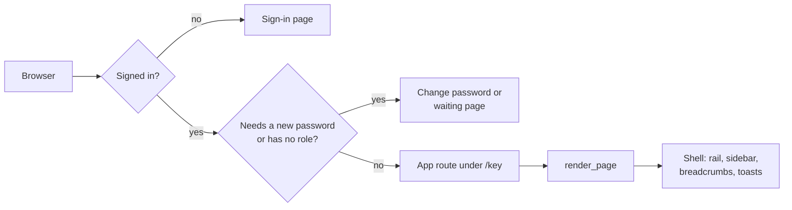

Lattice is a platform for internal web applications. It is a Python package
that supplies everything those applications have in common:

- sign-in, users, roles and sessions;
- the navigation shell and Ctrl+J search;
- preferences, the light and dark themes, and the audit log;
- the UI components, starting with the standard grid.

An application built on Lattice supplies only its own pages, tables and rules.

You build an **app** as a separate Python package. A **host** is the small
program you deploy: it lists the apps it runs. The same app can run in several
hosts, and one host can run several apps side by side, under one sign-in and
one navigation.

## What an app gets

When an app is added to a host, it gets all of this without writing it:

| Area | What the app gets |
|---|---|
| Sign-in | Password and OIDC single sign-on (Entra ID, Okta, Keycloak…), forced password change, a waiting page for users with no role |
| Users and access | Users, roles and sessions, managed in Administration; `require_roles` on routes, `roles=` on pages, grids and actions |
| Shell | An icon rail, a section sidebar, breadcrumbs, page titles and a status bar, all built from the app's list of pages |
| Search | Ctrl+J finds the app's pages, its records and its help topics, each with a preview |
| Lists | The standard grid: search, filters, views, sorting, paging, multi-select, bulk and row actions with confirm and input dialogs, a side panel, column chooser, CSV export, live refresh and keyboard control |
| Look and feel | Shared page macros, icons, five CSS layers, light and dark themes, per-user density and time format |
| Audit | Every grid action writes an audit event per row; a timeline macro shows a record's history |
| Help | The app's Markdown topics appear in Help, in Ctrl+J and behind F1 on each of its pages |

## Five ideas

Everything in these docs builds on five ideas.

### 1. The host chooses the apps

A host is a few lines of Python:

```python
from lattice.host import create_app
import lattice_notes

app = create_app(apps=[lattice_notes.APP])
```

`create_app` checks each app, registers its pages, grids and help, and returns
an ordinary FastAPI application. If an app breaks a rule (a route outside its
URL prefix, a template outside its folder, a broken help link), the host does
not start, and the error names the app and the problem.

### 2. An app is described by its manifest

Each app exports one `AppManifest`. It lists everything the app adds:

- its pages (`nav`) and routes (`routers`);
- its grids, Ctrl+J sources and home page tiles;
- its templates, static files, icons and help.

Lattice reads the manifest; it never imports app code by name. See
[App manifest](reference/app-manifest.md).

### 3. Every app has its own namespace

An app's key, for example `notes`, is its namespace:

- its URLs start with `/notes`;
- its grid keys start with `notes.`;
- its templates live in `templates/notes/`;
- its icons are `notes:name`;
- its CSS applies only inside `[data-app="notes"]`.

Two apps cannot collide, and one app's styles cannot change another's pages.

### 4. Apps import only `lattice.api`

`lattice.api` is the public surface: the manifest, the grid classes, rendering
helpers, auth dependencies and the database base class. Everything else in
Lattice is internal and may change. A test enforces this rule. See
[Python API](reference/api.md).

### 5. Lists are grids

Every list of records is a `GridSpec`: a query plus a description of columns,
filters, views and actions. Lattice draws the page and handles paging,
selection, dialogs and export. Every list in every app therefore looks and
behaves the same, and a user who learns one list knows them all. See
[Grid](reference/grid.md).

## How a request flows



1. **Gates.** Every request passes the authentication middleware. It checks
   for a valid session cookie, a password that does not need changing, and at
   least one role. A request that fails a gate is redirected to the sign-in,
   change-password or waiting page.
2. **Route.** The app's route runs, with the signed-in user and a database
   session from FastAPI dependencies.
3. **Page.** The route calls `render_page(request, template, nav_key, …)`. The
   nav key tells the shell which page this is, so it can highlight the menu,
   build the breadcrumbs, set the title and choose the help topic for F1.
4. **Browser.** The page is plain server-rendered HTML. HTMX swaps in partial
   updates (grid rows, panels) and Alpine.js handles small client-side state
   (menus, dialogs). There is no single-page app and no JavaScript build step.

## Lattice's own apps

Lattice ships three apps of its own, built with the same `AppManifest` as yours:

- **Home**: the start page, with count tiles from every app.
- **Administration**: users, roles, sessions, the audit log, system information and the UI kit.
- **Account**: each user's profile, password, preferences and sessions.

Every host runs them.

## Not built yet

Charts, graphs and forms generated from JSON Schema are planned but do not
exist yet. See [Not built yet](building-apps/not-built-yet.md).

## The stack

Python 3.14, FastAPI, Jinja2 templates, HTMX and Alpine.js (vendored, no npm),
SQLAlchemy 2 and Alembic. The workspace is managed with uv. Development uses
SQLite; production moves to Postgres.

## Next

- [Getting started](getting-started/index.md): run Lattice on your machine.
- [Your first app](getting-started/first-app.md): build a small app from an empty folder.
- [Reference](reference/index.md): every public class, setting and command.
